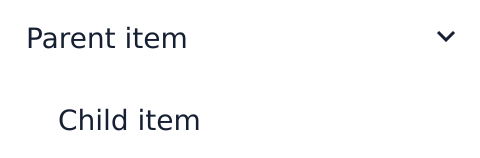
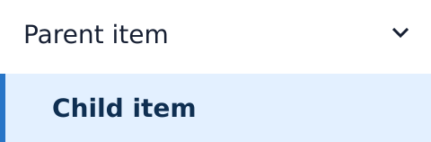

# Torrone

Torrone keeps reusable UI design examples for business applications, so humans and AI can refer to the same pictures and explanations when designing a screen.

Start with the **[visual catalog](catalog/README.md)**: application shells, navigation items, dialog frames and individual components, shown as independent images for each represented state. The catalog captures approximate appearance and meaningful visual differences. It helps you choose a pattern and explain your intent without fixing the product's styling or implementation.

## Try a menu example

Suppose a screen needs navigation items with a visible selection and one level of child indentation. [MENU-001](catalog/menus/one-level/README.md) shows those appearances independently of the surrounding application shell.

| Unselected child | Selected child |
| --- | --- |
|  |  |

1. Open the [MENU-001 entry](catalog/menus/one-level/README.md) and follow a state-image link. On GitHub, the README and PNGs can be viewed directly.
2. Compare the state names, short descriptions and source/proposal labels. Here, the child indentation and selection emphasis are the useful relationships; the sample labels and exact styling are illustrative.
3. Use the entry ID, relevant images and their explanation in your screen design or implementation brief. State which relationships you want to retain and which product requirements apply.
4. Decide navigation, permissions, keyboard operation and other unpictured behavior in the consuming application's requirements. A disabled picture does not decide when an item must be disabled.

Return to the [catalog list](catalog/README.md#available-examples) to choose another pattern. To see the HTML galleries, download and extract the repository ZIP, or use a local checkout, then open `catalog/index.html` in a browser. The catalog needs no build or package installation. GitHub's HTML file view displays source; use the Markdown entries and PNG links when browsing there.

## Use an example in your product

Begin with the screen's purpose, Business Design and target platform. Choose an example whose responsibility fits the screen. A Shell shows the relationship between major regions; a menu or component shows its own visual states. A dialog-frame example supplies regions for replaceable content, rather than the calling screen or a particular search workflow.

Check the entry's platform, provenance, visual-acceptance record and limits before reusing it. **Source-supported** and **new proposal** describe where a design came from. Human visual acceptance is a separate decision; it does not turn a static image into a tested interaction model.

Adapt theme/colors, typography, spacing, dimensions and exact placement to the product. Preserve only the coarse relationships you choose to adopt. Keep business rules, state-transition conditions, accessibility and shared interaction requirements explicit in their own design sources. The [catalog guide](catalog/README.md#what-the-images-communicate) explains this boundary.

When behavior needs a concrete example, consult the [curated References](references/README.md). An approved entry identifies an executable Reference HTML, its bounded operation model, guidance and human-approval evidence. Use it within that scope and apply the consuming application's [shared interaction requirements](docs/application-interaction.md). Catalog visual acceptance and executable Reference approval remain independent.

## Where to look next

| Location | What it contains |
| --- | --- |
| [Visual catalog](catalog/README.md) | Current image examples, state lists, provenance and visual-acceptance links. |
| [Curated References](references/README.md) | Executable interaction designs and their separate approval scopes. |
| [Product Foundation](docs/product-foundation.md) | Product purpose and design principles, with the background of the Reference HTML approach. |
| [Development and review](docs/development-workflow.md) | Authoring, review, evidence and curation procedures. |
| [Working review surfaces](review/) | Draft or experimental examples; consult curation to identify approved originals. |
| [Experiment archive](docs/poc/) | Historical research and verification evidence. `profile/`, `templates/` and `prompts/` preserve earlier Manifest/OKF research. |

The current catalog is a small collection of reusable examples. Torrone supplies no production frontend runtime or automatic screen generator. Its images do not establish pixel-perfect, cross-browser, device or accessibility conformity; implementation and verification belong to the consuming product.
