# 文書タブ · アイコン改訂草案

文書を切り替える親タブと、表示中の文書の中で「明細」「履歴」などを切り替える子タブのデザイン。PCとスマホで、タブの状態ごとに画像と説明を対にしている。

この草案は #67 の確認済みの関係をもとに、アイコンとその配置を更新したもの。差し替えた12枚は、同じ設計を組み立てたブラウザーの状態画像で、今回の改訂については人の確認待ち。 [原案のレビュー](https://github.com/mk3008/torrone/issues/67)

閉じる×と件数ボタンの矢印には、実装先で使っているアイコンセットを優先する。指定がなければ Lucide などの一般的なセットを使う。記号はラベルの高さに収まる程度とし、単一行の文字と垂直中央をそろえる。押せる範囲は記号より広く取る。例のアイコンは16px。 [Lucide](https://lucide.dev/icons/)

## 表示を切り替える条件

親と子の列ごとに、補助ボタンのない通常の並べ方で、全タブに必要な横幅とその列に使える幅を比べる。必要な幅が使える幅以下なら全件を表示し、横送りや「ほか」ボタンは表示しない。

| 全件を並べると使える幅を超える列 | 表示 |
| --- | --- |
| PC | タブ列を残し、左右の横送りボタンを出す。 |
| スマホ | 選択中の1タブと「ほか」ボタンを出す。左右の横送りボタンは出さない。 |

使える幅や表示するタブが変わったときは、親子それぞれで判定し直す。収まるようになった列は全件表示に戻す。個々のタブの寸法や省略の扱いは、実装先の通常表示のルールに従う。

## PC

### 通常の未選択タブ

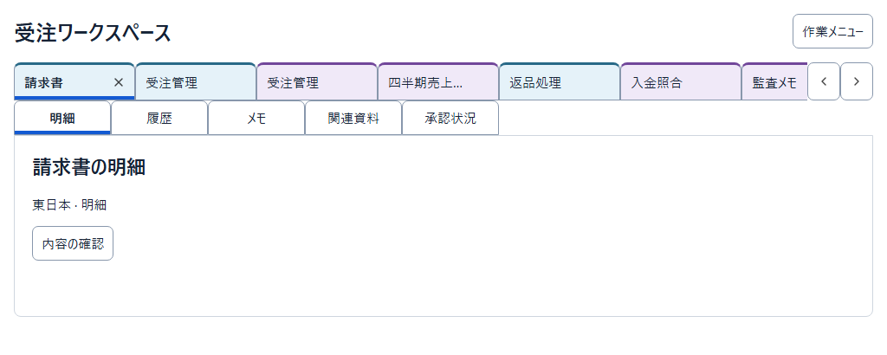

タブには枠線を付け、同じ列の文書タブは幅をそろえる。未選択で操作対象になっていないタブは、閉じるボタンを隠して見た目をすっきりさせる。新しく開いたタブは右端に追加する。既に開いているタブは、利用者が覚えている位置に残る。

### 選択中のタブ

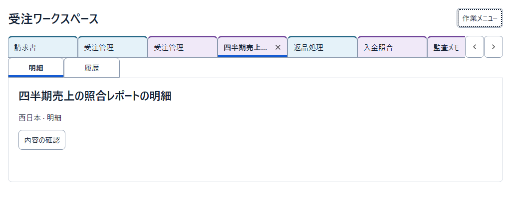

選択中のタブは**下辺の線**で示す。グループは**淡い背景色と上辺の実線**で補助的に示し、同じタブ上で選択と所属を見分けられるようにする。同じグループのタブが離れて並ぶこともある。グループの境目も通常の枠線でつなぎ、追加の余白を取らない。

子タブ列は、文書タブ列のすぐ下に左揃えで置く。間に縦の空白を挟まず、選択中の文書に属する項目だと分かるようにする。

### マウスを重ねたタブ

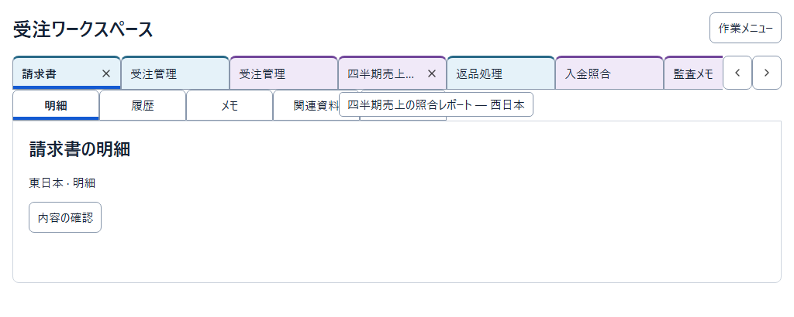

収まりきらないタブ名は、末尾を「…」で省略する。マウスを重ねるとタブの右端に閉じるボタンが現れる。タブ幅と文字の位置を保ち、隣のタブが動かないようにする。

カードにはタブ名の全文と、必要に応じて所属先を表示する。同じ名前の文書があっても、切り替える前に見分けられるようにする。

### キーボードでフォーカスしたタブ

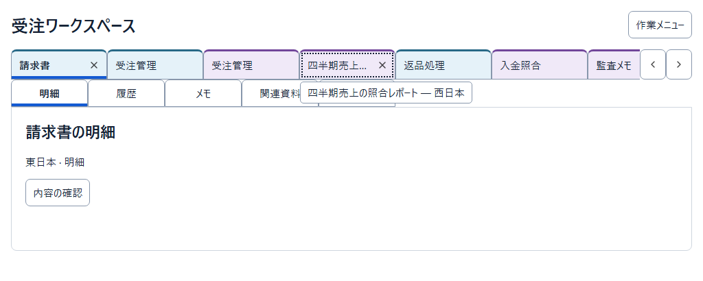

タブの内側の点線で、キーボードで操作する対象を示す。表示中の文書は下線で分かる。キーボードフォーカスでも、マウスを重ねたときと同じようにタブ名の全文と所属先を確認できる。図ではフォーカス中のタブに閉じるボタンも表示している。

### タブ列が画面幅に収まらない場合

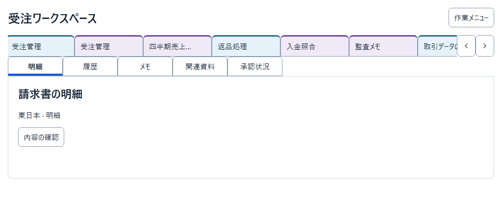

タブ列はマウスホイールと左右のボタンで横に送れるようにする。ボタンが見えていれば、ホイール操作を知らない人やホイールがない人も移動できる。タブ列を送る操作では表示範囲だけが動き、選択中の文書は切り替わらない。図で送った距離は一例。

## スマホ

**親と子それぞれの列で、タブが一列に収まるかを判定する。** 収まる列は全件表示し、直接選べるようにする。収まらない列は選択中のタブと残り件数のボタンを表示する。子タブ列は親の直下に左揃えで置く。閉じるボタンは選択中の文書タブに表示する。

**幅の配分（引き継ぎ比較を受けた追記案）。** 収まらない列では、「ほか」ボタンのラベルとアイコンに必要な幅を取り、選択中のタブが残り幅を使う。空きがあるうちからタブ名が省略されるのを防ぎ、今開いている文書や項目を読み取りやすくする。

### 両方の列が収まる

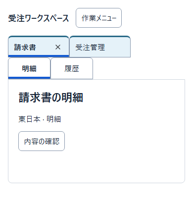

### 文書タブ列だけが収まらない

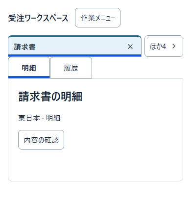

### 子タブ列だけが収まらない

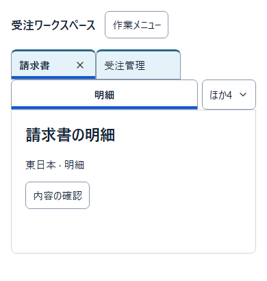

### 両方の列が収まらない

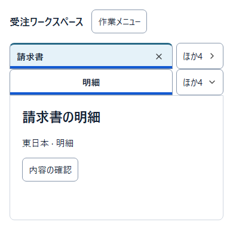

### 残り件数のボタン

表示中のタブを除いた件数を「ほか2」のように短く示す。表示する言語に合わせて語順を含めた文言全体を用意し、ボタンの幅はその文言に合わせる。読み上げ名には画面上のラベルを含めたうえで、「文書を切り替える」「項目を切り替える」と操作の違いを補う。

親と子で件数ラベルの形式が同じなので、**押す前に結果を見分けられるよう、矢印の向きを意図的に変える。** 親の右向きは別の選択画面への移動を示す。子の下向きはその場でリストが開くことを、上向きはリストが開いていることを示す。

### ほかの文書を開いた状態

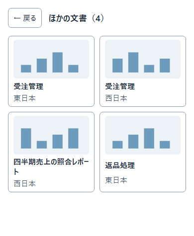

文書は、タブ名・サムネイル・必要に応じた所属先をカードで表示する。図では「受注管理」が2件あり、所属先を読んで選び分けられる。カードを選ぶと文書が切り替わり、その文書に属する子タブが表示される。

### ほかの子タブを開いた状態

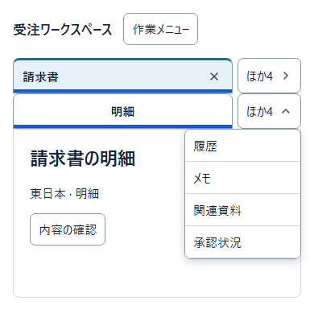

ボタンの直下に右端をそろえてドロップリストを開く。どのボタンで開いたかが位置で分かるので、リストは見出しを挟まず、隠れていた子タブ名から始める。項目を選ぶとリストが閉じ、表示中の文書内でその項目に切り替わる。

### 子タブを選んだあと

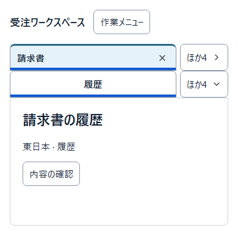

リストから選んだ「履歴」を子タブ列に出し、対応する内容を表示する。直前まで表示していた「明細」はリストに戻る。既存の子タブを切り替える操作では、隠れている件数は変わらない。

## 適用範囲と実装時の確認

図中の名前、色、書体、寸法、サムネイルの中身は例示。カードやリストの細かな見た目は、それぞれのデザイン仕様に準じる。グループを識別することが操作に必要な場合は、色以外でも所属が分かる方法を用意する。

画像は見え方を確認するためのもの。スクロール、フォーカスの移動と表示、全文カードの閉じ方、押せる範囲、拡大や画面幅が変わったときの切り替え、読み上げ、タブの選択と閉じる操作は、利用先のアプリで確認する。 [Torroneの操作要件](https://github.com/mk3008/torrone/blob/main/docs/application-interaction.md)

### Choose control sizes when the product leaves them open

Follow explicit product dimensions first. When they are unspecified, use the consuming application's standard size for a comparable control. If the application has no comparable control, start with the platform's standard component size where available. For a custom control with no size to inherit, use nearby controls as a scale reference and allow sufficient space for the intended input, including touch.

Review the result in the composed screen at the intended viewport widths. For stacked document tabs, check how much room the two rows leave for document content. Verify that labels and focus remain visible and that separate actions, such as closing a tab, have enough room to operate.

